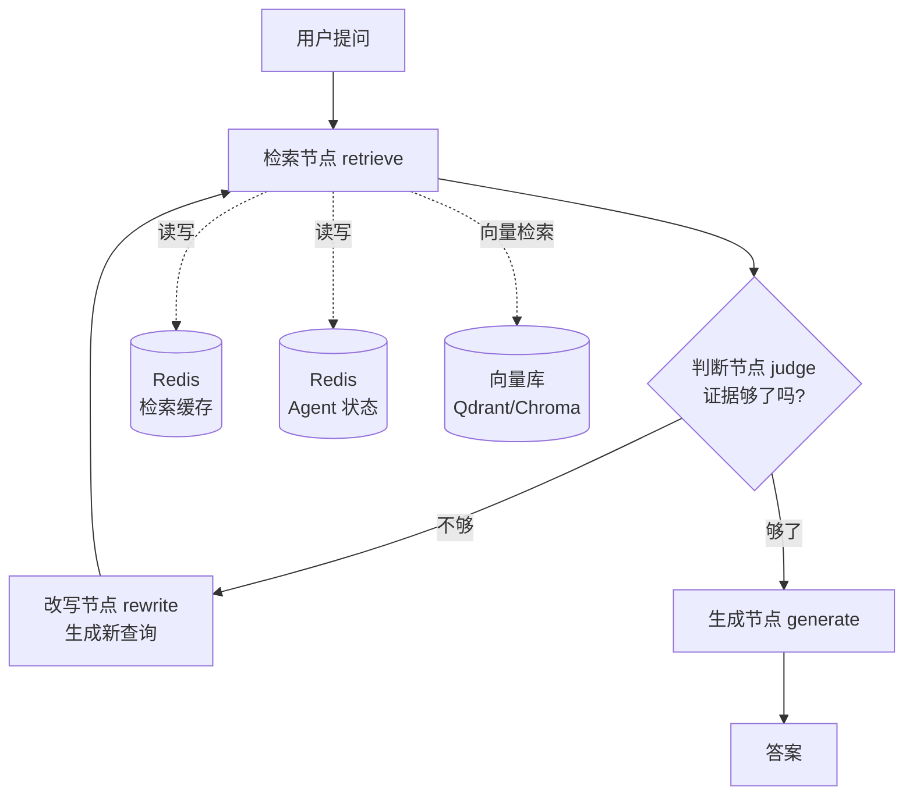

# 多跳检索问答 Agent —— 项目实施计划

> 一份能直接照着做的计划。目标不是"做完一个项目"，而是**产出简历上那几行有数字的描述**。

---

# 0. 项目定位

## 一句话

> **基于 LangGraph 的自适应多跳检索问答系统**：把"检索 → 判断证据是否充分 → 改写查询 → 再检索"抽象为状态机，并在 HotpotQA 上对比三种检索策略，量化提升效果。

## 为什么这个题目适合做简历项目

| 特点 | 说明 |
|---|---|
| **有公开 benchmark** | HotpotQA 有标准答案 + 支撑文档标注，数字有权威性 |
| **技术点集中** | 只做"多跳检索"这一件事，不撒胡椒面 |
| **四个技术栈各司其职** | LangChain / LangGraph / Redis / RAG 都有真实用途，不是硬塞 |
| **可对比、可量化** | 三种策略跑同一份评测集，提升幅度清清楚楚 |
| **有天然难点** | 判断"够不够"、查询改写、停止条件——够聊 30 分钟 |

## 不做什么（很重要）

明确划掉，避免战线拉长：

- ❌ 不做**前端界面**（网页按钮、聊天框）
- ✅ **要做薄 Web 层**（FastAPI + SSE 流式）——投 AI 应用岗必需，见阶段 6
- ❌ 不做用户系统、权限、多租户
- ❌ 不做多模态（图片/语音）
- ❌ 不做微调
- ❌ 不做 K8s 部署（Docker Compose 足够）

---

# 1. 最终产出清单

做完这个项目，你手上应该有：

| 产出 | 用途 |
|---|---|
| **1 个可运行的仓库** | GitHub，有 README + 架构图 |
| **1 份 200 条评测集** | `data/eval/eval_set.jsonl` |
| **3 组对比实验数据** | `results/*.json`，三种策略的指标 |
| **1 个错误分析 notebook** ⭐ | `notebooks/02_error_analysis.ipynb`——**面试加分项** |
| **1 份架构图** | README 里的 mermaid 图 |
| **简历描述 3 行** | 见第 9 节 |
| **面试问答准备** | 见第 10 节 |

---

# 2. 技术栈分工（每个都用得有道理）

| 技术 | 在这里干什么 | 为什么不是硬塞 |
|---|---|---|
| **RAG** | 检索支撑文档 → 生成答案 | 核心机制 |
| **LangChain** | 文档加载、切分、Embedding 封装、检索器、Prompt 模板 | 用在其擅长的基础设施部分 |
| **LangGraph** ⭐ | **多跳状态机**：检索节点 / 判断节点 / 改写节点 / 生成节点 + **条件边**（够了？不够？） | **这正是在"有循环和条件分支"时才该用 LangGraph** |
| **Redis** ⭐ | ① 检索结果缓存（多跳会重复查）② 子查询缓存 ③ Agent 中间状态（checkpoint） | 有可量化的收益（命中率 / 检索次数下降） |
| **Qdrant / Chroma** | 向量库 | 用 Docker 起，和 Redis 一起 compose 编排 |
| **Docker Compose** | 一键起 Redis + 向量库 + 应用 | 顺带把你学的 Docker 用上 |

## 架构图（放 README 里）



---

# 3. 目录结构

```
multi-hop-rag/
├── README.md                      # 项目说明 + 架构图 + 实验结果
├── pyproject.toml                 # 依赖（建议用 uv 管理）
├── .env.example                   # 环境变量模板（API key 等）
├── .gitignore                     # 必须排除 .env 和 data/raw
├── docker-compose.yml             # Redis + Qdrant + 应用
├── Dockerfile
│
├── configs/
│   └── default.yaml               # 所有可调参数集中在这
│
├── data/
│   ├── raw/                       # HotpotQA 原始 json（不进 Git）
│   ├── processed/
│   │   └── corpus.jsonl           # 切分后的文档库
│   └── eval/
│       └── eval_set.jsonl         # ⭐ 200 条评测集
│
├── src/multihop_rag/
│   ├── config.py                  # 配置加载
│   │
│   ├── data/
│   │   ├── load_hotpotqa.py       # 下载 + 清洗 + 抽取文档库
│   │   └── build_eval_set.py      # ⭐ 构建评测集
│   │
│   ├── retrieval/
│   │   ├── vector_store.py        # 向量库封装（Qdrant/Chroma）
│   │   ├── embedder.py            # Embedding 模型封装
│   │   ├── retriever.py           # 单跳检索
│   │   ├── reranker.py            # 重排序（可选，阶段 6 再加）
│   │   └── cache.py               # ⭐ Redis 检索缓存
│   │
│   ├── agents/
│   │   ├── state.py               # LangGraph State 定义
│   │   ├── nodes.py               # 四个节点：retrieve/judge/rewrite/generate
│   │   ├── graph.py               # 组装图 + 条件边
│   │   └── strategies.py          # ⭐ 三种策略：single / fixed_2hop / adaptive
│   │
│   ├── generation/
│   │   └── generator.py           # LLM 调用封装
│   │
│   ├── eval/
│   │   ├── metrics.py             # Recall@k / MRR / EM / F1
│   │   └── runner.py              # 跑评测，输出 results/*.json
│   │
│   └── cli.py                     # 命令行入口
│
├── notebooks/
│   ├── 01_explore_data.ipynb      # 数据探索（问题类型分布等）
│   └── 02_error_analysis.ipynb    # ⭐⭐ 错误分析——面试最能聊的部分
│
├── scripts/
│   ├── download_data.py
│   ├── build_index.py
│   └── run_experiments.py         # 一键跑三种策略并对比
│
└── results/
    ├── s1_single_hop.json
    ├── s2_fixed_2hop.json
    ├── s3_adaptive.json
    └── comparison.md              # 对比表格
```

## 关于目录结构的两点说明

**① `src/` 分层是刻意的**

```
data/       → 数据处理（和模型无关）
retrieval/  → 检索相关（可单独测）
agents/     → 编排逻辑（策略在这切换）
generation/ → LLM 调用
eval/       → 评测（独立，可复用）
```

**面试官看目录就知道你有没有工程概念。** 把 `retrieval` 和 `agents` 分开，说明你理解"检索"和"编排"是两件事。

**② `strategies.py` 是关键设计**

三种策略共用同一套检索器和生成器，**只换编排方式**。这样对比才公平，也说明你懂"控制变量"。

---

# 4. 分阶段里程碑

**总时长约 2.5 ~ 3 周**（每天 3~4 小时）。每个阶段都有**能跑通的产出**，随时可停。

| 阶段 | 目标 | 时长 | 验收标准 |
|---|---|---|---|
| **0** | 环境准备 | 0.5 天 | Redis 和向量库能起来，能跑通最小脚本 |
| **1** | 单跳 RAG 基线 | 2~3 天 | 输入问题能返回答案（哪怕不准） |
| **2** | ⭐⭐ **评测体系** | 2 天 | 得到"单跳 = XX% 召回 / XX F1" |
| **3** | 固定两跳 | 2 天 | 数字比阶段 2 有提升 |
| **4** | ⭐⭐⭐ **自适应多跳 Agent** | 4~5 天 | 数字再提升，且能演示"跳数自适应" |
| **5** | Redis 缓存优化 | 1~2 天 | 有命中率和检索次数降低的数字 |
| **6** | ⭐ **Web 层（FastAPI + SSE）** | 2~3 天 | 浏览器能看到多跳过程实时输出 |
| **7** | 收尾（错误分析 / 文档 / Docker） | 2 天 | 仓库能一键跑起来，README 完整 |

## ⚠️ 最重要的建议：阶段 2 必须**尽早做**

**90% 的人把评测放到最后，结果发现自己一直在瞎调。**

```
❌ 错误顺序：写完所有功能 → 最后才建评测 → 发现不知道哪版更好
✅ 正确顺序：基线一跑通 → 立刻建评测 → 之后每一步改动都有数字反馈
```

**阶段 2 之后，你每改一个参数都能知道"变好了还是变差了"。**

---

## 阶段 0：环境准备（0.5 天）

**要做的事：**

1. 建项目目录、初始化 Git
2. 用 `uv` 装依赖（`pip` 也行）
3. 写 `docker-compose.yml`，起 Redis + Qdrant
4. 申请 LLM API key（写进 `.env`）
5. 下载 HotpotQA 数据

**验收：**

```bash
docker compose up -d          # Redis + Qdrant 起来
redis-cli ping                # → PONG
python -c "import langchain, langgraph; print('ok')"
ls data/raw/                  # 看到 HotpotQA 的 json
```

**⚠️ 注意**：`.gitignore` 一定要排除 `data/raw/`、`data/processed/`、`.env`。

---

## 阶段 1：单跳 RAG 基线（2~3 天）

**要做的事：**

1. **加载 HotpotQA**，抽取所有段落形成文档库 → `corpus.jsonl`
2. **向量化 + 建索引**（写进 Qdrant）
3. **实现单跳检索**：问题 → top-k 段落
4. **实现生成**：把 top-k 段落塞进 prompt → LLM 出答案
5. **串成 CLI**：`python -m multihop_rag.cli ask "你的问题"`

**验收：**

```bash
python -m multihop_rag.cli ask "《三体》的作者毕业于哪所大学？"
# → 打印检索到的 top-5 段落 + LLM 生成的答案
```

**这一阶段大概率答不准——那正是我们要测出来的基线。** 别急着优化，先去建评测。

---

## 阶段 2：评测体系（2 天）⭐⭐ 全项目最关键

**要做的事：**

1. 从 HotpotQA 抽 **200 条**，生成 `eval_set.jsonl`
2. 实现指标：`recall@k`、`mrr`、`em`、`f1`
3. 写 `eval/runner.py`：跑完 200 条，输出 `results/s1_single_hop.json`
4. **得到基线数字**

**验收：**

```bash
python scripts/run_experiments.py --strategy single
# → results/s1_single_hop.json
# → 控制台打印：
#    Evidence Recall@5: 0.58
#    Answer F1:         0.41
```

**⭐ 这个数字就是你简历上"从 X 提升到 Y"的那个 X。**

---

## 阶段 3：固定两跳（2 天）

**要做的事：**

1. 实现"固定两跳"：检索一次 → 把问题 + 第一次结果拼成新查询 → 再检索 → 合并证据 → 生成
2. **不做判断，强制搜两次**
3. 跑评测

**验收：**

```
s1_single_hop:  Recall@5 0.58  F1 0.41
s2_fixed_2hop:  Recall@5 0.72  F1 0.55   ← 有提升
```

**为什么先做固定两跳？**

因为**它是自适应多跳的对照基线**。如果自适应还不如固定两跳，说明你的"判断"没做好——**这个对照能防止你自我欺骗**。

---

## 阶段 4：自适应多跳 Agent（4~5 天）⭐⭐⭐ 核心

**要做的事：**

1. **定义 State**：

```python
class MultiHopState(TypedDict):
    question: str              # 原始问题
    queries: list[str]         # 已执行过的查询
    evidences: list[str]       # 已收集的证据
    hop: int                   # 当前跳数
    is_sufficient: bool        # 证据是否充分
    answer: str                # 最终答案
```

2. **实现四个节点**：

| 节点 | 干什么 | 关键点 |
|---|---|---|
| `retrieve` | 用最新查询检索 top-k | 结果**去重**（避免重复证据） |
| `judge` ⭐ | **让 LLM 判断"现有证据能否回答问题"** | 输出结构化 `{sufficient: bool, missing: str}` |
| `rewrite` ⭐ | **根据缺失信息生成新查询** | 输入：原问题 + 已有证据 + 缺失什么 |
| `generate` | 证据够了，生成答案 | 要求**引用证据** |

3. **组装图 + 条件边**：

```python
builder.add_conditional_edges(
    "judge",
    lambda s: "generate" if s["is_sufficient"] or s["hop"] >= MAX_HOP else "rewrite",
)
```

4. **设计停止条件**（至少三个）：

| 条件 | 说明 |
|---|---|
| 证据充分 | judge 判断够了 |
| 达到最大跳数 | `hop >= 3`（防止无限循环） |
| 查询没变化 | 新查询和已搜过的重复 → 停 |

5. **串联 Redis**：缓存每次检索结果

**验收：**

```
s3_adaptive:  Recall@5 0.86  F1 0.71   ← 明显优于固定两跳
```

**并且能演示"自适应"：**

```
简单问题 → 1 跳就停
困难问题 → 3 跳才停
→ 平均跳数 1.7，比固定两跳（2.0）更省
```

**⭐ "平均跳数更少但效果更好"——这句话本身就是个亮点。**

---

## 阶段 5：Redis 缓存优化（1~2 天）

**要做的事：**

1. 实现检索缓存（key = 归一化后的 query，value = 检索结果）
2. 埋点统计：**缓存命中率**、**实际检索次数**
3. 对比开/关缓存的差异

**验收：**

```
缓存命中率:            41.3%
平均检索次数:  2.7 → 1.6   (-40.7%)
端到端延迟:    3.2s → 2.1s  (-34.4%)
```

**⭐ 这一阶段是"Redis 有真实价值"的证据。**

---

## 阶段 6：Web 层（FastAPI + SSE）（2~3 天）⭐ AI 应用岗必需

**为什么放在这里而不是更早？**

```
阶段 1~5：核心是"把多跳检索做对 + 拿到数字"
          → 此时 judge/rewrite 的 prompt 会反复改
          → 接口长什么样完全不重要

阶段 6：核心逻辑稳定了，再包一层 API
       → 2~3 天就能做完
       → 而且这时你才知道"该暴露哪些字段"
```

**先有内核，再有外壳。** 反过来会反复改接口。

**要做的事：**

1. **接口设计**（就这几个，别贪多）

| 方法 | 路径 | 说明 |
|---|---|---|
| GET | `/` | 演示页面 |
| GET | `/health` | 健康检查 |
| GET | `/stats` | 缓存命中 / 当前配置 |
| POST | `/ask` | 普通问答 |
| POST | `/ask/stream` | ⭐ **SSE 流式**，实时推送每一跳 |

2. **⭐ 流式接口是本阶段的亮点**

   长任务不能让用户干等。把 Agent 的每一步推出去：

   ```
   event: retrieve  → {"hop":1, "query":"...", "titles":[...]}
   event: judge     → {"sufficient":false, "missing":"...", "reasoning":"..."}
   event: rewrite   → {"new_query":"...", "used_entities":["..."]}
   event: retrieve  → {"hop":2, ...}
   event: judge     → {"sufficient":true, ...}
   event: done      → {"answer":"yes", "hop":2}
   ```

   **实现上不重写任何逻辑**——只是把 `graph.astream(stream_mode="updates")` 的输出转成 SSE。

3. **⭐ 一个关键认知（面试可以讲）**

   ```
   agents/ 是核心，api/ 和 cli.py 都只是"入口适配器"
   → 所以加 Web 层时，核心代码【一行没改】
   → 这就是分层架构的价值
   ```

4. **Docker 化**：写 `Dockerfile` + compose 加一个 `api` service

   - 分层构建：先 `COPY pyproject.toml` 装依赖，再 `COPY src/`（利用层缓存）
   - `docker-compose.yml` 里用 **服务名当主机名**（`REDIS_URL: redis://redis:6379`）
   - `depends_on` 配 `condition: service_healthy`（真正等就绪，不只是启动顺序）

**验收：**

```bash
docker compose up -d --build
# 浏览器打开 http://localhost:8000
# 输入问题 → 能看到"第1跳检索 → 判断不够 → 改写 → 第2跳 → 判断够了 → 答案"逐条实时出现
```

**这一段的面试价值**：可以直接演示。面试官问"你怎么做的"，你打开浏览器跑一遍，**比说十分钟都管用**。

---

## 阶段 7：收尾（2 天）

**必做：**

1. **错误分析 notebook** ⭐⭐（最容易忽略，但面试最加分）

   ```
   把答错的题分类：
     - 检索失败（没找到正确文档）      → 占比 ?
     - 判断失误（证据够了却说不够）    → 占比 ?
     - 改写跑偏（新查询无关）          → 占比 ?
     - 生成错误（证据对了但答错）      → 占比 ?
   
   然后针对占比最大的那类，说你的改进方向
   ```

   **面试官问"你这个项目还有哪些不足"时，这张表就是答案。** 比说"还在优化"强 100 倍。

2. **README**：一句话介绍 + 架构图 + 实验数据表 + 快速开始 + API 说明

3. **Docker 化 + compose**：`docker compose up -d --build` 一键起全套

4. **简历描述**：填进真实数字

---

# 5. HotpotQA 数据处理

## 5.1 下载哪个版本

| 版本 | 说明 | 建议 |
|---|---|---|
| **distractor** | 每题给 10 篇文档，其中 2 篇是支撑文档 | ✅ **用这个**，文档量可控 |
| fullwiki | 要在整个维基百科里检索 | ❌ 太难，不是你的重点 |

**下载**：
- 官网 `hotpotqa.github.io`
- 或 HuggingFace Datasets：`hotpot_qa`（`distractor` 配置）
- ⚠️ 数据集的具体规模/字段以官方为准，用之前确认一下

## 5.2 数据结构长什么样

```json
{
  "_id": "5a8b57f25542995d1e6f1371",
  "question": "Were Pavel Urysohn and Leonid Levin born in the same country?",
  "answer": "yes",
  "type": "comparison",
  "level": "hard",
  "supporting_facts": [["Pavel Urysohn", 0], ["Leonid Levin", 1]],
  "context": [
    ["Pavel Urysohn", ["Pavel Samuilovich Urysohn ...", "...", ...]],
    ["Leonid Levin",   ["Leonid Anatolievich Levin ...", "...", ...]],
    ... 共 10 篇
  ]
}
```

## 5.3 ⭐ 四个关键字段（决定了你的项目怎么做）

| 字段 | 用途 |
|---|---|
| `question` | **评测集的"问题"** |
| `answer` | **评测集的"标准答案"** |
| `supporting_facts` | ⭐ **"应该检索到的文档"的金标准！** |
| `type` / `level` | 分类分析（bridge vs comparison，easy/medium/hard） |

**`supporting_facts` 是 HotpotQA 最值钱的地方：**

```
supporting_facts: [["Pavel Urysohn", 0], ["Leonid Levin", 1]]
                    └──── title ────┘  └ 第几句 ┘

→ 告诉你：回答这个问题，需要检索到这两篇文档
→ 这就是算"召回率"的 ground truth
→ 不用你自己标！
```

**对比一下：**

| | 自己找数据 | 用 HotpotQA |
|---|---|---|
| 评测集的"问题" | 自己编 | ✅ 现成 |
| 评测集的"答案" | 自己写 | ✅ 现成 |
| "应检索哪些文档" | **要人工标注（最累）** | ✅ **现成！** |

**这就是为什么我推荐它——它把 RAG 项目最痛苦的一步免费给你了。**

## 5.4 处理流程

```python
# 伪代码，看清步骤

# ① 加载
data = load_json("hotpot_dev_distractor_v1.json")

# ② 抽取文档库（去重！同一篇文档会被多个问题引用）
corpus = {}
for item in data:
    for title, sentences in item["context"]:
        if title not in corpus:
            corpus[title] = {
                "title": title,
                "text": " ".join(sentences),   # 句子拼成段落
            }
# → 几万篇文档

# ③ 切分（HotpotQA 已是段落级，先按段落用）
chunks = [{"id": t, "text": v["text"], "title": t} for t, v in corpus.items()]

# ④ 向量化 + 写进向量库
for chunk in chunks:
    vec = embedder.encode(chunk["text"])
    vector_store.upsert(id=chunk["id"], vector=vec, payload=chunk)
```

## 5.5 三个要注意的点

**① 文档库要用"全量"，评测只用"抽样"**

```
文档库：用 dev 集里的所有段落（几万篇）  ← 保证检索有难度
评测集：随机抽 200 条问题               ← 保证评测成本可控
```

如果文档库太小（比如只用 200 条问题对应的文档），**检索会变得过于简单**，测不出多跳的价值。

**② 切分策略：先用段落级，再做对比实验**

```
阶段 1-4：直接用 HotpotQA 的段落（干净、现成）
阶段 6：  尝试"把段落再切细"和"段落+标题拼接"做对比
          → 这能展示你的分块策略能力
```

**③ Embedding 模型选择**

| 模型 | 维度 | 特点 | 建议 |
|---|---|---|---|
| `BAAI/bge-small-en-v1.5` | 384 | 小、快，CPU 可跑 | ✅ 先用这个 |
| `BAAI/bge-base-en-v1.5` | 768 | 效果更好，稍慢 | 阶段 6 对比用 |
| `all-MiniLM-L6-v2` | 384 | 最轻量 | 备选 |

> 💡 **BGE 系列做检索时，query 侧建议加指令前缀**（比如 `"Represent this sentence for searching relevant passages: "`），文档侧不加。这是 BGE 的用法细节，**面试时提到会很加分**。

**④ LLM 选择（涉及成本，重要）**

| 方案 | 成本 | 说明 |
|---|---|---|
| **DeepSeek API** | 极低 | ✅ 推荐，便宜、够用 |
| 通义 / 智谱 | 低 | 备选 |
| **Ollama + qwen2.5** | 免费 | 本地跑，但慢 |
| OpenAI | 高 | 200条×3策略×多次调用，会有点贵 |

**成本估算（重要，先算再跑）：**

```
200 条评测 × 3 种策略 = 600 次问答
自适应多跳每条约 3~4 次 LLM 调用（judge/rewrite/generate）
→ 约 2000 次调用

每次约 1500 input tokens + 100 output tokens
→ 约 3M input tokens

按 DeepSeek 价格估算：几块钱人民币级别
```

> ⚠️ **具体价格以官方为准。** 但结论是：**用便宜模型，成本可以忽略。**
> **建议：先用 20 条小样本跑通全流程，确认无误再跑 200 条。**

---

# 6. 评测体系

## 6.1 评测集格式

`data/eval/eval_set.jsonl`，每行一条：

```json
{"qid": "001", "question": "Were Pavel Urysohn and Leonid Levin born in the same country?", "answer": "yes", "gold_titles": ["Pavel Urysohn", "Leonid Levin"], "type": "comparison", "level": "hard"}
```

| 字段 | 来源 | 用途 |
|---|---|---|
| `question` | HotpotQA | 输入 |
| `answer` | HotpotQA | 算 EM / F1 |
| `gold_titles` ⭐ | `supporting_facts` 的 title 去重 | **算召回率** |
| `type` / `level` | HotpotQA | 分类分析 |

## 6.2 规模：200 条，按类型**分层抽样**

**别随机抽 200 条就完事**——要保证各类问题都有，否则无法分析"哪类提升最大"：

| 维度 | 分布建议 |
|---|---|
| `type` | bridge 120 条 + comparison 80 条 |
| `level` | hard 60 + medium 100 + easy 40 |

**为什么要分层？**

```
跑完实验你可以说：
  "自适应多跳在 hard 问题上提升最大（+38%），
   在 easy 问题上提升有限（+6%），
   说明简单问题不需要多跳——这正是自适应策略的价值"
```

**⭐ 这种"分场景分析"是面试官最想听的东西。**

## 6.3 指标定义

### 检索指标（不需要 LLM，便宜，可以全量跑）

| 指标 | 定义 | 说明 |
|---|---|---|
| **Evidence Recall@k** ⭐ | 检索出的 top-k 文档里，命中了多少 `gold_titles` | 主指标 |
| **Full Recall@k** | gold_titles **全部**出现才算命中（更严格） | 辅助 |
| **MRR** | 第一个正确文档的排名倒数，取平均 | 看排序质量 |

```python
# Evidence Recall@5 的算法
def evidence_recall(retrieved_titles, gold_titles, k=5):
    top_k = set(retrieved_titles[:k])
    hit = top_k & set(gold_titles)
    return len(hit) / len(gold_titles)      # 召回比例

# Full Recall@5（全召回率，更严格）
def full_recall(retrieved_titles, gold_titles, k=5):
    return 1.0 if set(gold_titles) <= set(retrieved_titles[:k]) else 0.0
```

> 💡 **建议两个都算。** `Evidence Recall` 看"找到多少"，`Full Recall` 看"是否凑齐"。
> **多跳的价值恰恰体现在 Full Recall 上**——因为多跳就是为了"凑齐"。

### 生成指标

| 指标 | 定义 | 注意 |
|---|---|---|
| **EM (Exact Match)** | 归一化后完全匹配 | HotpotQA 官方指标 |
| **F1** | 词级 F1 | HotpotQA 官方指标 |
| **答案准确率** | 用 LLM 当裁判，或人工抽查 | 方便但需校准 |

**归一化处理**（不然 EM 会很虚低）：

```python
def normalize(s):
    s = s.lower()
    s = re.sub(r'\b(a|an|the)\b', ' ', s)     # 去冠词
    s = re.sub(r'[^\w\s]', '', s)             # 去标点
    return ' '.join(s.split())
```

### ⭐ 一个省钱技巧

| 评测类型 | 规模 | 原因 |
|---|---|---|
| **检索指标** | **全量（几千条）** | 不用调 LLM，只是向量检索，很快很便宜 |
| **生成指标** | **抽样 200 条** | 要调 LLM，成本高 |

**这样既保证统计可靠，又控制成本。**

---

# 7. 三种策略的对比设计

**核心原则：只变一个变量，其他全部相同。**

| 相同的东西 | 说明 |
|---|---|
| 同一个文档库 | 同一份向量索引 |
| 同一个 Embedding 模型 | 不换 |
| 同一个 top-k | 比如都是 5 |
| 同一个生成 LLM | 同一个模型、同一个 prompt 模板 |
| 同一份评测集 | 同样的 200 条 |

**只有"检索的编排方式"不同：**

| 策略 | 描述 | 伪代码 |
|---|---|---|
| **S1 单跳** | 检索一次就生成 | `ctx = retrieve(q); ans = gen(q, ctx)` |
| **S2 固定两跳** | 强制检索两次，合并证据 | `ctx1 = retrieve(q)`<br>`q2 = q + ctx1 摘要`<br>`ctx2 = retrieve(q2)`<br>`ans = gen(q, ctx1+ctx2)` |
| **S3 自适应多跳** ⭐ | LangGraph 判断够不够，动态决定 | `循环：retrieve → judge → (rewrite | break)` |

## 预期结果形态

```
策略              Evidence Recall@5   Full Recall@5    F1      平均跳数
S1 单跳                0.58             0.31         0.41       1.00
S2 固定两跳            0.79             0.62         0.58       2.00
S3 自适应多跳          0.86             0.74         0.71       1.72  ⭐
                                          ↑            ↑         ↑
                                     提升最明显    效果最好   还更省
```

> ⚠️ **上表是"预期形态"，不是真实结果——真实数字要你自己跑出来。**
> **但注意 S3 的形态：效果最好，平均跳数还比固定两跳少。这个"更省还更好"就是你的核心卖点。**

---

# 8. 时间与成本估算

## 时间

| 阶段 | 时长 | 累计 |
|---|---|---|
| 0 环境 | 0.5 天 | 0.5 |
| 1 单跳基线 | 2~3 天 | 3.5 |
| 2 评测体系 | 2 天 | 5.5 |
| 3 固定两跳 | 2 天 | 7.5 |
| 4 自适应多跳 | 4~5 天 | 12 |
| 5 Redis 优化 | 1~2 天 | 14 |
| 6 Web 层（FastAPI + SSE） | 2~3 天 | 17 |
| 7 收尾 | 2 天 | 19 |

**约 19 个工作日 ≈ 4 周（每天 3~4 小时）**

> 如果时间紧，可以砍掉 Web 层（-2~3 天）。但**投 AI 应用岗建议保留**——它是唯一能"现场演示"的产出。

## 成本

| 项 | 估算 |
|---|---|
| LLM API | **几元 ~ 几十元**（取决于模型和评测规模） |
| 服务器 | 0（本地跑） |
| 向量库 / Redis | 0（Docker 本地） |
| **合计** | **基本可以忽略** |

**省钱要点：先用 20 条小样本跑通，再跑 200 条。**

---

# 9. 简历描述草稿

**先给模板，等你跑出真实数字后替换 `X` `Y`：**

## 版本 A（偏 Agent / 编排能力）

> **多跳检索问答 Agent**（个人项目）
> - 基于 **LangGraph** 将"检索-证据判断-查询改写-生成"抽象为状态机，通过条件边实现**自适应多跳**（1~3 跳动态决策），解决单次检索无法覆盖多跳推理链路的问题。
> - 构建 **200 条分层评测集**（bridge/comparison × 难度），对比单跳、固定两跳、自适应多跳三种策略：**Full Recall@5 从 31% 提升至 74%，答案 F1 从 0.41 提升至 0.71**，且平均跳数（1.72）低于固定两跳（2.00）。
> - 引入 **Redis 缓存检索结果与子查询**，缓存命中率 **41%**，平均检索次数下降 **40%**，端到端延迟降低 **34%**。

## 版本 B（更简洁）

> **多跳检索问答 Agent**：基于 LangGraph 实现自适应多跳检索，在 HotpotQA 上构建 200 条评测集，通过证据判断与查询改写将 Full Recall@5 从 31% 提升至 74%；用 Redis 缓存检索结果，命中率 41%，检索次数降低 40%。

## 写作要点

| 要 | 不要 |
|---|---|
| **数字**（百分比、绝对值） | "实现了""集成了""搭建了" |
| **对比**（A 从 X 到 Y） | "效果良好" |
| **技术取舍**（为什么这么做） | 罗列用到的技术名词 |
| **具体规模**（200 条、3 种策略） | "大量数据" |

**⚠️ 面试之前，确保你能解释简历上的每一个数字是怎么来的。**

---

# 10. 面试追问清单（提前准备答案）

**这 12 个问题，面试官大概率会问：**

| # | 问题 | 你该怎么答（要点） |
|---|---|---|
| 1 | **为什么需要多跳？单跳为什么不行？** | 答案不在"最相似的文档"里——问题里的线索和答案所在的文档不是同一实体，向量相似度不够，排到 top-k 之外 |
| 2 | **怎么判断"证据够了"？** | 让 LLM 做结构化判断：给它原问题 + 已有证据，输出 `{sufficient: bool, missing: str}`；并说明这个判断本身有误差（见错误分析） |
| 3 | **查询怎么改写？** | 输入"原问题 + 已有证据 + 缺什么"，让 LLM 生成新查询；并做**去重**（避免重复搜） |
| 4 | **怎么防止无限循环 / 跑偏？** | 三个停止条件：证据充分 / 达到最大跳数 3 / 新查询与历史重复。另外要求改写必须引用证据中的实体 |
| 5 | **为什么用 LangGraph 而不是 LangChain 的 Agent？** | 因为有**循环和条件分支**，需要显式状态机；LangGraph 的状态可持久化（对应 Redis checkpoint），流程可观测、可复现 |
| 6 | **Redis 真的有用吗？还是硬塞的？** | 有量化收益：多跳会重复检索，缓存命中率 41%，检索次数降 40%。**而且给出具体数字** |
| 7 | **你的评测集怎么保证公平？** | 用 HotpotQA 官方 `supporting_facts` 作为金标准（不是我标的）；三种策略用同一份评测集、同一模型、同一 top-k，只变编排方式 |
| 8 | **指标为什么用 Recall@5 和 F1？** | Recall 衡量"有没有找到正确证据"（检索层），F1 衡量"答得准不准"（生成层）。**分开测才能定位是检索问题还是生成问题** |
| 9 | **提升主要来自哪里？** | 看错误分析：主要是 hard 和 bridge 型问题提升最大；easy 问题提升有限——**说明自适应策略的价值在于"按需多跳"而不是"无脑多跳"** |
| 10 | **这个项目还有什么不足？** ⭐ | **拿错误分析说话**：判断节点失误占比 X%（有证据却说不够）、改写跑偏占 Y%…下一步打算用"更细的 judge prompt + few-shot 校准"改进 |
| 11 | **加 Web 层时你改了多少核心代码？** ⭐ | **一行没改。** 因为 `agents/` 是核心，`api/` 和 `cli` 只是"入口适配器"。这是分层架构的价值——加一个入口不用动内核 |
| 12 | **为什么要做流式输出？怎么实现的？** | 多跳要 3~10 秒，同步等待体验差；流式让用户看到"正在第 2 跳检索"，也让 Agent 的决策过程可观测。实现上把 `graph.astream(stream_mode="updates")` 的逐节点输出转成 SSE，**没有重写任何检索/编排逻辑** |

> **第 10 题是最重要的一题。** "能说出自己项目的不足，并有数据支撑"——这是区分"做过"和"跑过教程"的关键。
>
> **第 11 题是"架构理解"的检验。** 能说出"核心和入口分离"的人，和只会往 main.py 里堆代码的人，工程素养完全不同。

---

# 11. 常见坑（提前避开）

| # | 坑 | 后果 | 对策 |
|---|---|---|---|
| 1 | **把评测放到最后** | 一直瞎调，不知道哪版更好 | ⭐ **阶段 2 就建评测** |
| 2 | 文档库太小 | 检索太简单，测不出多跳价值 | 文档库用**全量**（几万篇） |
| 3 | 三种策略用不同参数 | 对比不公平 | **只变编排方式**，其他全相同 |
| 4 | 一次性跑 200 条 × 3 策略 | 调试时代价大 | **先用 20 条跑通** |
| 5 | 不做去重 | 多跳反复搜到同一文档，证据冗余 | 检索结果按 chunk id **去重** |
| 6 | 没有最大跳数限制 | LLM 不收敛，无限循环烧钱 | 硬性 `MAX_HOP=3` |
| 7 | 把 API key 提交到 Git | 泄露，可能被盗刷 | `.gitignore` 排除 `.env`，提供 `.env.example` |
| 8 | 只报一个总分数 | 无法分析，面试聊不深 | **按 type / level 分层报告** |
| 9 | 不做错误分析 | 面试被问"不足"时答不上来 | ⭐ **阶段 6 必须做** |
| 10 | 数字对不上 | 面试穿帮 | 简历上每个数字都要能追溯到 `results/*.json` |

---

# 12. 立刻可以开始的三个动作

**今天就能做：**

```bash
# ① 建目录、初始化 Git
mkdir multi-hop-rag && cd multi-hop-rag
git init

# ② 写 docker-compose.yml，把 Redis 和 Qdrant 起来
# ③ 下载 HotpotQA dev distractor 数据，看一眼真实结构
```

**明天开始阶段 1。**

---

# 附：如果时间不够，可以砍什么

| 可砍 | 影响 |
|---|---|
| 重排序（reranker） | 少一个优化点，不影响主线 |
| 多阶段 Docker 化 | 用 `docker compose up` 简单跑就行 |
| **Web 层**（FastAPI） | ⚠️ 投 AI 应用岗**建议保留**——它是唯一能现场演示的产出；投算法岗可砍 |
| Qdrant 换 Chroma | 不影响，但 Docker 编排的展示效果差一点 |

**不能砍的（这是项目的灵魂）：**

- ⭐ **200 条分层评测集**
- ⭐ **三种策略的对比实验**
- ⭐ **错误分析**
- ⭐ **自适应多跳（LangGraph 状态机）**
