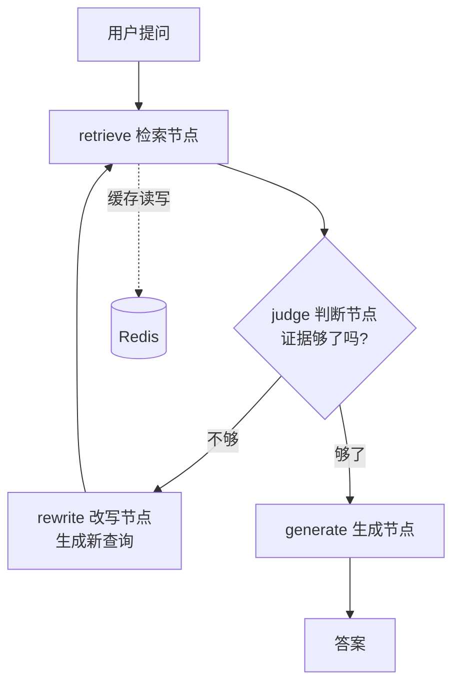

# 多跳检索问答 Agent

基于 **LangGraph** 的自适应多跳检索问答系统。在 HotpotQA 上对比 **单跳 / 固定两跳 / 自适应多跳** 三种检索策略，并通过错误分析驱动优化。

**在线演示**：http://47.109.78.39:8000 （打开后可点「示例问题」直接体验逐跳过程）

> 📋 详细实施计划见 [PLAN.md](PLAN.md) ｜ 🚀 部署说明见 [DEPLOY.md](DEPLOY.md)

---

## 实验结果（200 条分层评测集）

| 指标 | S1 单跳 | S2 固定两跳 | **S3 自适应** |
|---|---|---|---|
| Evidence Recall@5 | 0.885 | 0.943 | **0.960** |
| **Full Recall@5** | 0.780 | 0.890 | **0.925** |
| MRR | **0.948** | 0.938 | 0.947 |
| EM | 0.665 | **0.755** | 0.720 |
| F1 | 0.753 | **0.840** | 0.800 |
| 平均跳数 | 1.00 | 2.00 | **1.39** |
| 平均延迟 | **0.79s** | 1.54s | 2.52s |

**结论（含显著性检验，n=200）：**

- ✅ **多跳显著优于单跳**：Full Recall@5 从 **0.780 → 0.925（+14.5 点，z=3.9，p<0.001）**
- ⚠️ **自适应相对固定两跳没有统计显著优势**：检索指标 +3.5 点（7 条题，p≈0.24）、EM −3.5 点（7 条题，p≈0.42），**都在噪声范围内**
- ⚠️ **自适应的延迟反而更高**（2.52s vs 1.54s）—— 它减少了向量检索次数（1.39 vs 2.00 跳），但每跳多一次 judge 的 LLM 调用，净效果是变慢

> **为什么照实写**：200 条样本下 7 条题的差异不构成结论。与其把噪声当成果，不如写清机制和边界——这也是后续优化的方向。

### 优化历程（错误分析驱动，零额外成本）

| 轮次 | 改动 | Full Recall@5 | EM | F1 |
|---|---|---|---|---|
| v1 | 初始版本 | 0.900 | 0.550 | 0.620 |
| v2 | 修正 prompt：强制英文作答 + 减少过度放弃 | 0.915 | **0.700** | 0.787 |
| v3 | 增加答案规范化（prompt 拆解冲突指令 + `parse_answer` 后处理） | **0.925** | **0.720** | **0.800** |

**EM 0.550 → 0.720（+17.0 点），只改 prompt 和后处理，没换模型、没加成本。**

### 错误归因（v3，56 条错误 / 200 条）

| 类别 | 条数 | 占比 | 说明 |
|---|---|---|---|
| **A 检索失败** | 5 | 8.9% | 金标准文档没找全 |
| **B1 回答「无法确定」** | 3 | 5.4% | 模型主动放弃（v1 时是 24 条，prompt 修复后基本消失） |
| **B2 答案内容错误** | 30 | 53.6% | 选错实体 / 答案范围不匹配 / 题目歧义 |
| **B3 措辞格式差异** | 18 | 32.1% | 人名长度不一致等（**HotpotQA 标注本身不统一**） |

**关键洞察：91% 的错误来自生成层，检索只占 8.9%** —— 这直接改变了优化方向。

> 复现：`python scripts/error_analysis.py --strategy adaptive`

---

## 这个项目解决什么问题

标准 RAG 只检索**一次**就生成答案。但有些问题的答案**不在最相似的文档里**：

> 问题：《三体》的作者毕业于哪所大学？

```
向量检索返回的 Top-5（按相似度排序）：
  [1] 《三体》百科页          0.89   ← 最相似，但不含答案
  [2] 《三体》读后感          0.85
  [3] 三体电视剧介绍          0.83
  ...
  [12] 刘慈欣 个人页          0.58   ← 答案在这，但排第 12，没进 Top-5
```

**根本原因**：问题里的线索（《三体》）和答案所在的文档主题（刘慈欣）不是同一个实体，而问题里压根没有"刘慈欣"这三个字。

**多跳检索做的事**：用第一跳搜出来的新线索（刘慈欣）**再搜一次**，逐步补齐证据链。

---

## 架构



三种策略**共用同一个检索器和生成器**，只换编排方式（保证对比公平）：

| 策略 | 说明 |
|---|---|
| **S1 单跳** | 检索一次就生成（基线） |
| **S2 固定两跳** | 强制检索两次，不做判断（"傻"但有效的对照） |
| **S3 自适应多跳** ⭐ | LangGraph 判断够不够，动态决定跳数（1~3） |

> **为什么要 S2**：如果只和单跳比，无法区分提升来自"多搜一次"还是"自适应决策"。有了 S2 才能发现：**自适应目前还没体现出优势**。

---

## 三个核心技术设计

### 1. judge 用结构化输出，判断结果可统计

```python
class JudgeResult(BaseModel):
    sufficient: bool      # 证据够不够
    missing: str          # 还缺什么
    reasoning: str        # 判断理由
```

不是让 LLM 输出自由文本，而是用 Pydantic 约束——**这样"判断失败"也变成了可统计的量**。

prompt 里故意**偏向判"不够"**：多搜一次的代价远小于答错的代价。这是一个有意的取舍。

> ⚠️ 实践发现这个偏向在 v1 时过强（24 条错误回答"无法确定"），v2 已调整为"证据相关就给出最佳答案"。

### 2. rewrite 有硬约束：必须使用已有证据里的实体

```
原始问题里的词已经搜过且搜不到 → 必须引入【新词】
新词从哪来？→ 只能从第一跳搜到的证据里提取
```

这条约束把"改写"从**自由发挥**变成了**确定性操作**。rewrite 同时返回 `used_entities`，用于统计"约束是否有效"。

### 3. 四个停止条件（缺一不可）

| 条件 | 谁决定 | 位置 |
|---|---|---|
| 证据充分 | 🧠 LLM | judge → 条件边 |
| 达到最大跳数（3） | 💻 代码 | judge 开头，硬性保险 |
| 改写查询重复 | 💻 代码 | rewrite 节点 |
| 上一跳没有新证据 | 💻 代码 | judge 节点 |

**LLM 只掌控 4 个停止条件里的 1 个**——其余都是代码兜底。这是防止模型不收敛时无限烧钱的关键。

---

## 评测体系

**HotpotQA 的 `supporting_facts` 直接提供了"应该检索到哪几篇文档"**，这就是算召回率的金标准——不用自己标注。

| 层级 | 指标 | 说明 |
|---|---|---|
| **检索** | Evidence Recall@5 | 找到了多少比例的金标准文档 |
| **检索** | **Full Recall@5** ⭐ | 金标准文档**全部**找到才算命中 |
| **检索** | MRR | 第一个正确文档的排名倒数 |
| **生成** | EM / F1 | HotpotQA 官方指标 |

> **多跳的价值恰恰体现在 Full Recall 上**——因为多跳就是为了"凑齐"。

评测集按 `type`（bridge/comparison）和 `level`（easy/medium/hard）**分层抽样 200 条**，六种组合各不少于 10 条。

### ⚠️ 两个踩过的数据坑

1. **HotpotQA 的 `validation` split 里 `level` 整列都是 `hard`**（7405 条全一样），做不了分难度分析。
   → 改用 `train` split（90447 条，`{'medium': 56814, 'hard': 15661, 'easy': 17972}`）
2. **索引和评测集必须用同一批问题**（同一 config + 同一 seed），否则金标准文档不在索引里，指标全错。

---

## 已知不足与改进方向

**这是项目最诚实的部分，也是面试时最有话可讲的部分。**

| # | 不足 | 数据支撑 | 改进方向 |
|---|---|---|---|
| **1** | **自适应相对固定两跳没有显著优势** | EM 差 7 条题（p>0.4），延迟反而高 64% | 提升 judge 判断准确率；或对"第 2 跳必做"的场景直接用固定两跳 |
| **2** | **Redis 缓存命中率 <1%** | 实测 0.00%~0.36% | 当前设计是"子查询级缓存"，而一次评测内子查询不重复。应改为**问题级语义缓存**，并在"用户重复提问"场景下测量 |
| **3** | **HotpotQA 人名标注长度不统一** | 18 条 B3 类错误 | 标注问题，无法通过 prompt 修复。可考虑答案归一化词典 |
| **4** | **向量库只覆盖 600 题的候选文档（5881 篇）** | 不是完整维基 | 完整语料 66563 篇，在 1核2G 服务器上要跑约 2 天。属刻意的成本取舍 |
| **5** | **fastembed 模型缓存在容器 `/tmp`** | 每次重建容器要重下 50MB | 设置 `FASTEMBED_CACHE_PATH` 并挂卷 |
| **6** | **HTTP 头编码错误没有提前拦截**（已修复） | 见下方部署踩坑 | 已加启动期配置自检 |

---

## 部署：七个真实踩坑记录

项目部署在 **阿里云 1核2G CentOS 7** 服务器上。以下都是实际遇到并解决的问题——比一路顺风的部署更有参考价值。

| # | 现象 | 根因 | 解决 |
|---|---|---|---|
| **1** | `yum` 全部失效（`repolist: 0`） | CentOS 7 已 EOL，官方源和阿里云镜像都下架了 | 改用**静态二进制包**装 Docker（`docker-24.0.9.tgz`），完全绕开包管理器 |
| **2** | 构建镜像时容器被杀（OOM） | 1.7GB 内存 + 0 swap | 加 **4GB swap** + `vm.swappiness=10` |
| **3** | 建索引跑到一半抛 `ResponseHandlingException: timed out` | `qdrant-client` **默认超时只有 5 秒**，弱服务器上一批 upsert 经常超时 | 超时调到 **120s** + 写入**重试 3 次**（递增退避）+ 支持**断点续传** |
| **4** | 日志写中文时抛 `UnicodeEncodeError` | `python:*-slim` 镜像不带 locale，Python 把 `sys.stdout` 当 ASCII | 三层保险：Dockerfile 的 `ENV LANG=C.UTF-8`、容器 `-e PYTHONUTF8=1`、**代码级 `sys.stdout.reconfigure()` 兜底** |
| **5** | ⭐ 调用 LLM 时抛 `UnicodeEncodeError: ... position 10-13` | **`.env` 里的 API Key 还是中文占位符**。Key 会被拼进 HTTP 头 `Authorization: Bearer <key>`，而 **HTTP 头只能是 ASCII** | 修 Key；并在 `config.py` 加**非 ASCII 校验** + 覆盖所有占位符写法 |
| **6** | 改了 `.env` 但没生效 | **`docker restart` 不会重新读取 `--env-file`** —— 环境变量在**创建容器时**注入 | 必须 `docker rm` + `docker run` 重建（部署脚本已封装） |
| **7** | 启动自检明明执行了，日志却什么都看不到 | uvicorn 只配置自己的 logger，根 logger 无 handler → Python 回退到 `logging.lastResort`，**而它只处理 WARNING 及以上**，我们的 `logger.info` 被静默丢弃 | 给 `multihop_rag` 包 logger 挂独立 handler |

### ⭐ 坑 5 的根因链条（最隐蔽的一个）

```
.env.example 写的是      sk-在这里填你的key
config.py 只校验         key.startswith("sk-在这里")
但部署文档里写的是        sk-你的真实key          ← 两者不一致！
        ↓
占位符绕过校验
        ↓
Authorization: Bearer sk-你的真实key
        ↓
HTTP 头只能是 ASCII → httpx2.Headers() 构造失败
        ↓
异常一路冒泡到 SSE 接口 → 浏览器上显示报错
```

**教训：配置错误必须在启动时暴露，不能等第一次请求才炸。**
为此新增了 `startup_check.py`——启动时校验 LLM 配置 / 向量库 / Redis / 评测集，结果同时输出到日志和 `/health` 的 `config_errors` 字段。

### 启动自检的输出

```
07:42:49 | INFO | multihop_rag.retrieval.embedder    | 加载 embedding 模型: BAAI/bge-small-en-v1.5
07:43:40 | INFO | multihop_rag.retrieval.embedder    | 模型就绪，向量维度 = 384
07:43:41 | INFO | multihop_rag.retrieval.vector_store | Qdrant 已连接（timeout: 120s）
07:43:41 | INFO | multihop_rag.startup_check         | [自检] 向量库正常，hotpotqa 集合共 5881 条
07:43:41 | INFO | multihop_rag.startup_check         | ====================================================================
启动自检: 全部通过 ✅
====================================================================
```

---

## 快速开始

### 1. 启动依赖服务

```bash
docker compose up -d
docker compose ps          # 确认 redis 和 qdrant 都是 running
```

### 2. 安装依赖

```bash
# 推荐用 uv
uv venv && uv pip install -e ".[dev]"

# 或者 pip
python -m venv .venv
.venv\Scripts\activate        # Windows
pip install -e ".[dev]"
```

### 3. 配置 API Key

```bash
cp .env.example .env
# 编辑 .env，填入 DEEPSEEK_API_KEY
# ⚠️ Key 必须是纯 ASCII（形如 sk-a1b2c3...），不能有中文
```

### 4. 准备数据 + 建索引

```bash
python scripts/build_index.py --download     # 下载 HotpotQA 并建索引（最慢的一步）
python scripts/build_eval_set.py --size 200  # 构建评测集
```

> ⚠️ 这两个脚本必须用**同一批问题**（都读 config 的 `data.corpus_questions` + 同一个 seed），否则评测集的金标准文档不在索引里。

### 5. 试一个问题（用评测集里的题）

```bash
python scripts/demo.py --n 2
```

### 6. 跑对比实验

```bash
# ⭐ 先用小样本验证流程，省 API 费
python scripts/run_experiments.py --limit 20

# 确认没问题再跑全量
python scripts/run_experiments.py
```

结果写到 `results/comparison.md`。

### 7. 错误分析

```bash
python scripts/error_analysis.py --strategy adaptive
```

自动把答错的题归类（检索失败 / 无法确定 / 内容错误 / 措辞差异），并估算各类的改善空间。

---

## Web 层（FastAPI）

Web 层是**薄**的——它只把 HTTP 请求转成对 `agents/strategies.py` 的调用，**核心代码一行不改**。

### 启动

```bash
# 本地（需要先起 Redis 和 Qdrant）
uvicorn multihop_rag.api.main:app --reload --port 8000

# 或者用 Docker（推荐，顺便把 Redis 和 Qdrant 一起起来）
docker compose up -d --build
```

浏览器打开 **http://localhost:8000** —— 演示页可以**实时看到 Agent 的每一跳决策**，并带「示例问题」按钮（来自评测集，保证能答出来）。

### 接口

| 方法 | 路径 | 说明 |
|---|---|---|
| GET | `/` | 演示页面（浏览器直接看多跳过程） |
| GET | `/docs` | **自动生成的交互式 API 文档**（FastAPI 自带） |
| GET | `/health` | 健康检查（缓存 + 向量库 + **配置自检结果**） |
| GET | `/stats` | 统计信息（缓存命中、当前配置） |
| GET | `/strategies` | 可用策略列表 |
| GET | `/examples` | ⭐ 评测集里的真实题目（给演示页用） |
| POST | `/ask` | 普通问答（同步返回） |
| POST | `/ask/stream` | ⭐ **SSE 流式**，实时推送每一跳过程 |

### 流式接口长什么样

`POST /ask/stream` 按 Agent 的执行顺序推送事件：

```
event: start
data: {"question": "Were Pavel Urysohn and Leonid Levin born in the same country?"}

event: retrieve
data: {"hop": 1, "query": "Were Pavel Urysohn and...", "new_evidence_count": 5, "titles": [...]}

event: judge
data: {"sufficient": false, "missing": "Pavel Urysohn 的出生国家", "reasoning": "只找到名字，没有出生地"}

event: rewrite
data: {"new_query": "Pavel Urysohn birthplace", "used_entities": ["Pavel Urysohn"]}

event: retrieve
data: {"hop": 2, "query": "Pavel Urysohn birthplace", "new_evidence_count": 3, ...}

event: judge
data: {"sufficient": true, "reasoning": "两个出生地都有了"}

event: done
data: {"answer": "yes", "hop": 2}
```

**这个接口的价值**：长任务不能让用户干等。把 Agent 的每一步决策推给前端，用户能看到"它正在第 2 跳检索"——**面试演示时效果最直观**。

> 实现上**没有重写任何逻辑**，只是把 LangGraph 的 `graph.astream(stream_mode="updates")` 输出转成 SSE 格式。

> ⚠️ 部署到 Nginx 后面时**必须关掉 `proxy_buffering`**，否则 SSE 会被缓冲、看不到实时效果。见 [DEPLOY.md](DEPLOY.md)。

---

## 目录结构

```
src/multihop_rag/
├── config.py              # 配置加载 + API Key 校验
├── runtime.py             # 懒加载单例（retriever / cache / llm）
├── startup_check.py       # ⭐ 启动期配置自检
├── api/                   # ⭐ Web 层：FastAPI + SSE 流式
├── data/                  # 数据处理
├── retrieval/             # 检索层：embedder / vector_store / retriever / cache
├── agents/                # 编排层：state / prompts / nodes / graph / strategies
├── generation/            # LLM 调用 + 答案规范化
├── eval/                  # 指标 + 实验运行
└── cli.py                 # 命令行入口

scripts/
├── build_index.py         # 建向量索引（支持断点续传）
├── build_eval_set.py      # 构建分层评测集
├── run_experiments.py     # 三策略对比实验
├── error_analysis.py      # ⭐ 错误归因分析
├── deploy-server.sh       # 服务器部署（docker run 版，不依赖 compose）
├── pack-for-deploy.ps1    # 打包（排除密钥和数据）
└── ...
```

**分层与依赖方向（只往下，不往上）：**

```
入口层   api/  ·  cli.py          用户怎么用
           ↓
评测层   eval/                    怎么衡量好坏
           ↓
编排层   agents/                  ⭐ 核心，多个入口共用
           ↓
能力层   retrieval/ generation/   用什么搜、怎么生成
           ↓
基础层   runtime/ config/ data/   支撑设施
```

**分层原因**：
- `retrieval`（怎么搜）和 `agents`（怎么编排）是两件独立的事，分开才能单独替换和测试
- **`agents/` 是核心，`api/` 和 `cli.py` 都只是入口适配器**——所以加 Web 层时核心代码一行没改

---

## 项目状态

- [x] 阶段 1：单跳基线
- [x] 阶段 2：评测体系（200 条分层评测集 + 检索/生成分离指标）
- [x] 阶段 3：固定两跳
- [x] 阶段 4：自适应多跳（LangGraph 状态机）
- [x] 阶段 5：Redis 缓存层（⚠️ 实测收益有限，见「已知不足」）
- [x] 阶段 6：错误分析 + 两轮 prompt 优化（EM 0.550 → 0.720）
- [x] 阶段 7：Web 层（FastAPI + SSE 流式）+ Docker 化
- [x] 阶段 8：部署到云服务器 + 启动期配置自检
- [ ] 阶段 9（计划中）：错误分析 notebook + 提升 judge 判断准确率
